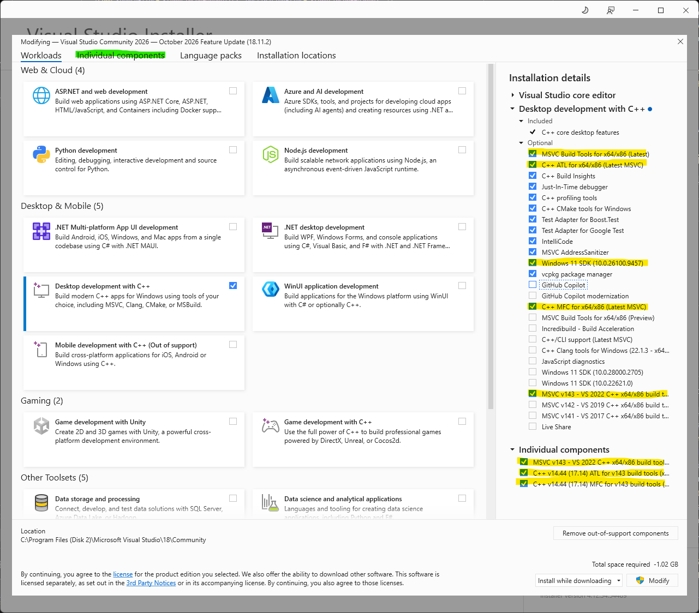
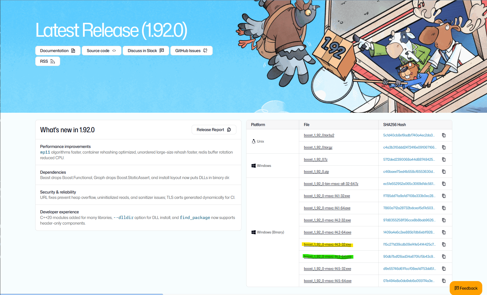

# Wally — Visual Studio 2026 Community setup

These steps install and configure **Visual Studio 2026 Community** (product version 18) so this repository can be opened and built. Wally began as a Visual C++ 5.0 / MFC application in 1998. The solution that is in the tree today was last saved from Visual Studio 2022 and still asks for that compiler. Visual Studio 2026 can install that compiler beside its own, which is what this guide sets up.

The Boost library and the user-specific output folders are called out at the end.  They are required before a finished build, and they are separate from installing the IDE.  Additional external library dependencies including zlibstat, libpng, and jpeg are included within the codebase directly due to some small project-specific changes.

The component names below match the Visual Studio 2026 installer documented for the 18.11 Stable channel (October 2026). A later update may show a slightly newer Windows SDK build number. Any installed Windows SDK whose version begins with `10.0` satisfies this solution.

## Project-specific Visual Studio build dependencies

Wally contains four projects:

| Project | Role | Platform toolset | Platform that builds | MFC |
| --- | --- | --- | --- | --- |
| Wally | MFC application (`Source/Wally/Wally.vcxproj`) | v143 | Win32 (x86) | Shared DLL |
| jpeg | Static library, libjpeg 9e | v143 | Win32 and x64 | No |
| zlibstat | Static library, zlib 1.2.13 | v143 | Win32 and x64 | No |
| libpng | Static library, libpng 1.6.39 | v143 | Win32 | No |

Details that decide which installer checkboxes matter:

- **Platform toolset `v143`** is the Visual Studio 2022 MSVC compiler (14.44). Every project in `Source/Wally.sln` is currently using `<PlatformToolset>v143</PlatformToolset>`. 
- **MFC in a shared DLL.** `Wally.vcxproj` sets `UseOfMfc` to `Dynamic`. The precompiled header (`Source/Wally/Stdafx.h`) includes `afxwin.h`, `afxext.h`, `afxdisp.h`, `afxcmn.h`, and `afxole.h`. MFC is an optional installer component and is absent from a default C++ install.
- **Character set is Not Set.** The project does not define `UNICODE` or `_MBCS`. Since Visual Studio 2015, the MFC component includes the single-byte and multibyte libraries, so there is no separate MBCS add-on to download.
- **Windows SDK `10.0`.** Each project sets `WindowsTargetPlatformVersion` to `10.0`, which means "the newest 10.0 SDK that is installed." The Windows 11 SDK (10.0.26100 or newer) is that SDK. `Stdafx.h` targets Windows 10 (`WINVER` and `_WIN32_WINNT` are `0x0A00`).
- **Win32 (x86), not x64, for the application.** Wally itself only has `Debug|Win32` and `Release|Win32`. In the solution, the **x86** solution platform is the one that builds Wally. x64 may come in the future.
- **C++20.** Wally compiles with `LanguageStandard` set to `stdcpp20`. That language mode is part of the MSVC toolset; it is not a separate installer component.
- **Bundled libraries.** libjpeg, zlib, and libpng ship in this repository and build as part of the solution. Boost does not. `WallyPropertySheet.props` uses the `BOOSTDIR` build macro to define where Boost is located.

Visual Studio Community is the correct free edition for an individual working on this open-source project, and for students and classroom use. A company that does not qualify for Community needs Professional or Enterprise instead; the workload and component list in this document is the same.

## 1. Download the Community installer

1. Go to [https://visualstudio.microsoft.com/downloads/](https://visualstudio.microsoft.com/downloads/).
2. Under **Visual Studio Community**, confirm the version line starts with **18** (Visual Studio 2026). The downloads page at the time of this guide showed **18.11.2**.
3. Click **Free download**. The file is a small bootstrapper, about 1 MB, named `VisualStudioSetup.exe` or similar. It downloads the rest during setup.

## 2. Start setup

1. Double-click the bootstrapper.
2. Approve the User Account Control prompt.
3. Wait while the Visual Studio Installer downloads. The first window is the installer itself, not the IDE.
4. If a license notice appears, continue.
5. When the workload window opens, stay on the **Workloads** tab. The product shown at the top should be **Visual Studio Community 2026**.

## 3. Select the C++ desktop workload

1. On the **Workloads** tab, check **Desktop development with C++**.
   Its component id is `Microsoft.VisualStudio.Workload.NativeDesktop`.
2. Other workloads are optional.  

With **Desktop development with C++** still selected, look at **Installation details** on the right. Then open the **Individual components** tab and use its search box to find each row in the tables below. A row that is already checked should stay checked.

### Required, and usually already checked with the workload

| Installer name | Why Wally needs it |
| --- | --- |
| **MSVC Build Tools for x64/x86 (Latest)** | Visual Studio 2026 compiler, MSVC 14.50 / toolset v145. Installed now so the later retarget has a compiler to switch to. |
| **Windows 11 SDK (10.0.26100 or newer)** | Satisfies `WindowsTargetPlatformVersion` of `10.0`. The build number after `10.0.26100` may be newer than the one named here. |
| **C++ core desktop features**, **C++ core features**, **Just-In-Time debugger** | IDE, MSBuild, and the debugger. These come in with the workload. |
| **C++ ATL for x64/x86 (Latest MSVC)** | Recommended with the workload. Wally's MFC OLE headers are covered by the MFC component below; leave ATL checked. |

The x64/x86 packages include the 32-bit libraries. Wally's executable is Win32, so an x64-only or ARM-only toolset is not enough.

### Required, and unchecked until you check them

Check all three of these on the **Individual components** tab:

| Installer name | Component id | Why |
| --- | --- | --- |
| **MSVC v143 - VS 2022 C++ x64/x86 build tools (v14.44-17.14)** | `Microsoft.VisualStudio.Component.VC.14.44.17.14.x86.x64` | The Visual Studio 2022 compiler, registered with MSBuild as platform toolset **v143**. That is the toolset the four projects request today. |
| **C++ v14.44 (17.14) MFC for v143 build tools (x86 & x64)** | `Microsoft.VisualStudio.Component.VC.14.44.17.14.MFC` | MFC headers and libraries for the v143 toolset. A build of `Wally.vcxproj` fails without this, because the project links the shared MFC DLL. |
| **C++ MFC for x64/x86 (Latest MSVC)** | `Microsoft.VisualStudio.Component.VC.ATLMFC` | MFC headers and libraries for the Visual Studio 2026 toolset (v145). Needed when the projects are retargeted. |

The installer has a second entry that is easy to confuse with the first row: **MSVC v143 - VS 2022 C++ x64/x86 build tools (v14.44)**, without `-17.14` at the end (component id `Microsoft.VisualStudio.ComponentGroup.VC.Tools.143.x86.x64`). That entry copies the 14.44 compiler onto disk but registers it only as an older compiler version inside the **v145** toolset. It does **not** create a `v143` platform toolset. With only that entry installed, the project properties show **Visual Studio 2022 (v143) (not installed)**. Keep the entry whose name ends in **(v14.44-17.14)**.

Searching for `MFC` lists many entries, and the long v143 names are easy to miss. Search for `14.44` to see only the two v143 rows above. Search for `Latest MSVC` to find the third row.

**MSVC Build Tools for x64/x86 (Preview)** and every entry labeled **(MSVC Preview)** are prerelease builds of the next compiler. They update with each Visual Studio update and do not get servicing fixes. Wally does not use them; leave them unchecked.

If the search list also shows **C++ MFC for x64/x86 (MSVC v14.50)** or a later pinned version, that is the same latest MFC family. Checking **C++ MFC for x64/x86 (Latest MSVC)** is the one to rely on; it tracks the current released compiler.

These are all the components that were installed during the creation of this markdown file:




## 4. Open Wally and confirm the IDE can see the toolset

1. Choose **File > Open > Project/Solution**.
2. Browse to the clone of this repository and open `Source/Wally.sln`.
3. If a dialog offers to retarget the projects to a newer platform toolset, decline it. The v143 toolset installed above is what the project files require.
4. In the toolbar, set the solution configuration to **Debug** and the solution platform to **x86**. That platform is the one wired to Wally's `Debug|Win32` configuration. **Release | x86** is the matching release build. The **x64** solution platform does not build Wally, as x64 did not exist in 1998.
5. In Solution Explorer, right-click the **Wally** project and choose **Properties**.
6. Set the properties dialog's Configuration to **Debug** and Platform to **Win32**, then open **Configuration Properties > General**. You should see:

   | Property | Expected value |
   | --- | --- |
   | Platform Toolset | Visual Studio 2022 (v143) |
   | Use of MFC | Use MFC in a Shared DLL |
   | Character Set | Not Set |
   | Windows SDK Version | 10.0 (the installed Windows 11 SDK) |
   | C++ Language Standard | ISO C++20 (`/std:c++20`), on the C/C++ > Language page |

7. Repeat the toolset check on **jpeg**, **zlibstat**, and **libpng**. Each should also report **v143**. libpng's Win32 configuration is a static library named `libpng16`.

**Visual Studio 2022 (v143) (not installed)** means the v143 platform toolset is not registered with MSBuild. That happens even when the 14.44 compiler is on disk, if **MSVC v143 - VS 2022 C++ x64/x86 build tools (v14.44-17.14)** was not the entry that got installed (see section 3). Close Visual Studio, add the three components from section 3 with **Visual Studio Installer > Modify** or the `modify` command in section 7, and reopen the solution.


## 5. Boost install

The IDE is ready when section 4 checks out. The last task is to download the Boost library and use the solution's PropertySheet file to point to it.

1. Navigate to [Boost Latest Release page](https://www.boost.org/releases/latest/)
2. You have two options from here:
- Download the Windows source code files and build the binaries yourself
- Download the pre-built Windows binaries for msvc 14.3 toolset 32-bit
3. I **strongly** recommend downloading the pre-built binaries, it will save considerable time at the expense of a larger download.  I have built the binaries from source code previously, it takes a very long time, the bootstrapping is quirky, and you may end up building the wrong MFC run time that's incompatible with Wally.
4. You only need to download **boost_X_YY_Z-msvc-14.3-32.exe** at the time of writing (X_YY_Z = 1_92_0 as of October 2026).  This installer EXE file will extract all of the pre-built static LIB and dynamic DLL files for you, in the correct folders.  Just pick a destination folder and use that in the next step.  Optionally you can download the 64-bit binaries at the same time in the event I ever get around to converting Wally to a 64-bit application.
5. Edit `WallyPropertySheet.props` at the repository root and change the following:
```
<PropertyGroup Label="UserMacros">
    <BOOSTDIR>C:\Path\To\Boost</BOOSTDIR>
    <USER_TEMP>C:\Path\To\Temp</USER_TEMP>
</PropertyGroup>
```

Change BOOSTDIR to the root folder, where files such as `boost.css` and `boost.png` exist.  Wally's include path uses `$(BOOSTDIR)`. The linker looks for 32-bit Boost libraries in `$(BOOSTDIR)\lib32-msvc-14.3`, which matches the v143 toolset (MSVC 14.3x). Headers used from `Source/Wally/Stdafx.h` include Boost.PropertyTree, Boost.Interprocess, Boost.JSON, Boost.Algorithm, Boost.Spirit, Boost.Phoenix, Boost.Fusion, and Boost.Filesystem.

Both Debug and Release configurations of Wally write their executable output to `$(USER_TEMP)\Wally\Configuration\Win32`. Intermediate files for all of these projects go to `$(USER_TEMP)\Wally`.  You can delete this entire `$(USER_TEMP)\Wally` folder structure to start clean and not affect any of the source code, assuming you chose different folders for the solution and `$(USER_TEMP)`


